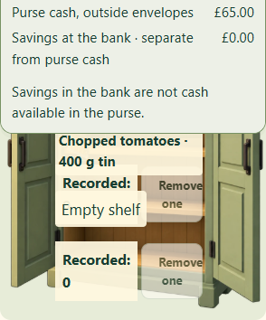
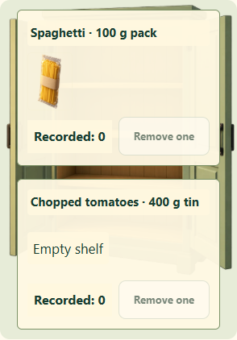
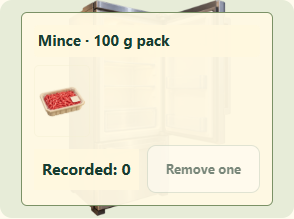

# Small-screen cooking controls and recovery

Base: `release/ipad` at `914724a6a9fc4cb199b9c38c607af8a6dd6f2934`. Separate from the Home exterior PR.

## Cause and fix

On a 360 px screen, pantry/fridge ingredient rows were absolutely positioned at fixed percentages of the decorative storage image. Their labels, products and counters grew taller than the allocated spacing and covered one another. The sticky balance panel could also cover the stock controls while the dialog scrolled. The recovery tests timed out because the ingredient could not be tapped; this was a presentation failure rather than a save-queue failure.

At widths of 700 px or less, ingredient close-ups now use content-sized grid rows. The existing storage art remains as decoration, with readable ingredient cards, wrapping products and the original touch/keyboard buttons. Balances remain visible in normal document flow for these storage dialogs. Wider layouts and other close-ups keep their existing behavior.

**Only `v3/style.css` changes at runtime.** Save/recovery logic, task snapshots, IDs, recipes, rewards, accounts and database code are unchanged. No migration, reset or deployment is involved.

## Verification

- Before: both original private recovery tests failed on the current release, and the new overlapping-row check failed in both private and demo builds (4/4 targeted cases failed as expected).
- After: **32/32 browser cases passed** at desktop, iPad portrait, iPad landscape and 360 px touch sizes, with no skipped or flaky cases.
- Both pantry and fridge controls were exercised with real touch actions and keyboard activation. The two original tests run unchanged.
- A completed unrelated cooking plan, learning/profile evidence, purchases and unknown future fields remain intact. The current recipe snapshot survives pause, reload and resume exactly.
- Private fixtures test a lost save response, an immutable pending request, later offline edits and recovery on reconnect. Demo tests exercise browser-only persistence and prohibit external traffic.
- `npm test`, Node save/recovery and cloud-sync checks passed. The actual private-fixture and demo builders, including demo isolation checks, were used.

The focused suite is `npm run test:cooking-recovery` and is added to the existing required save-and-recovery workflow without removing or weakening any existing checks. The existing recovery cases use a touch-enabled desktop context because their helper uses tap. Other sizes emulate iPad/touch layouts; physical iPad Safari is not claimed. No real learner account or records were used.

[Machine-readable results](review/cooking-recovery/TEST-RESULTS.json)

## Screenshots: private fixture at 360 px

Before: overlapping rows and the balance panel obscure stock controls.

After: separate content-sized ingredient rows.

## Demo at 360 px

