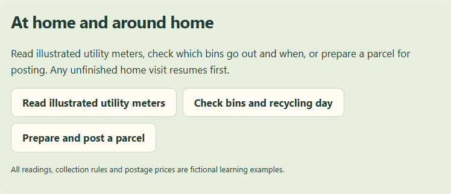
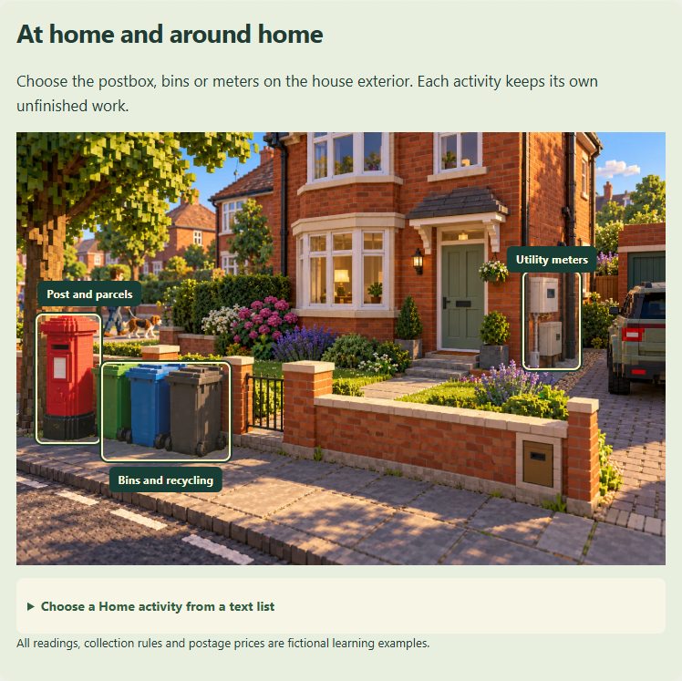
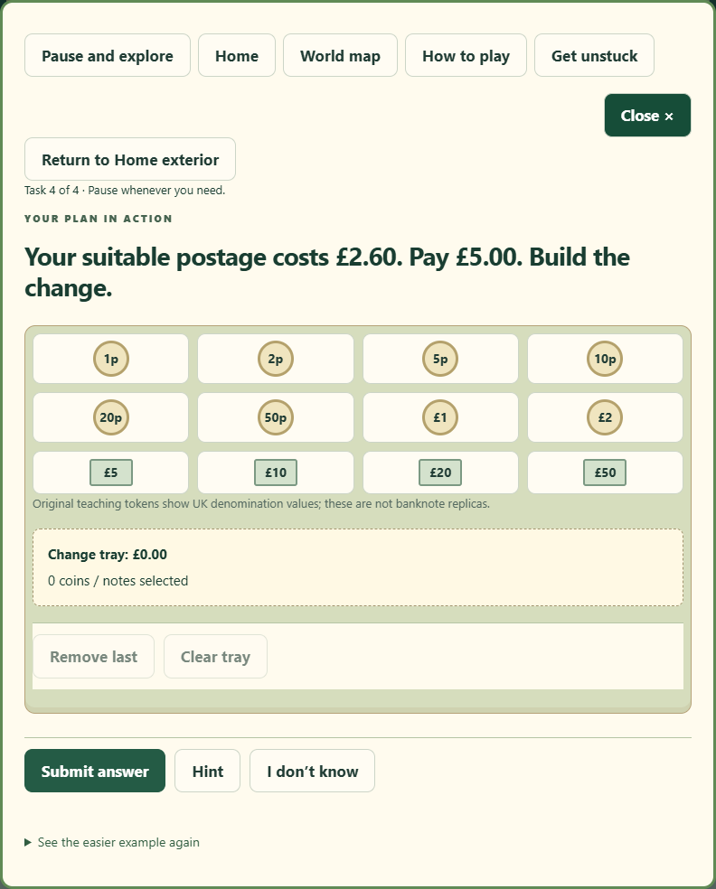
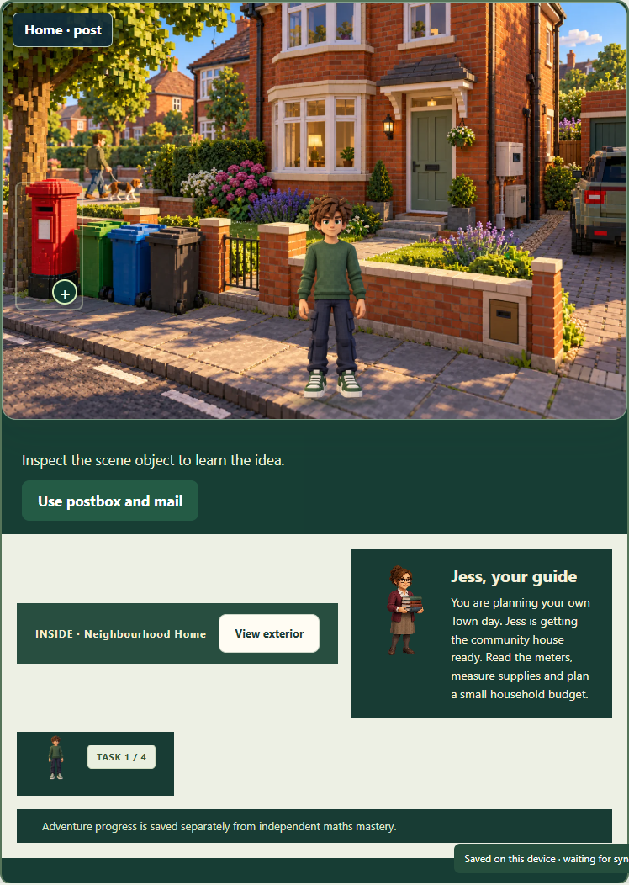
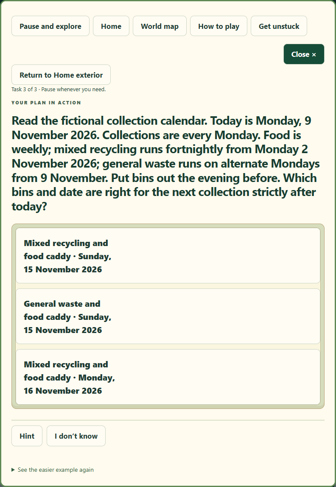
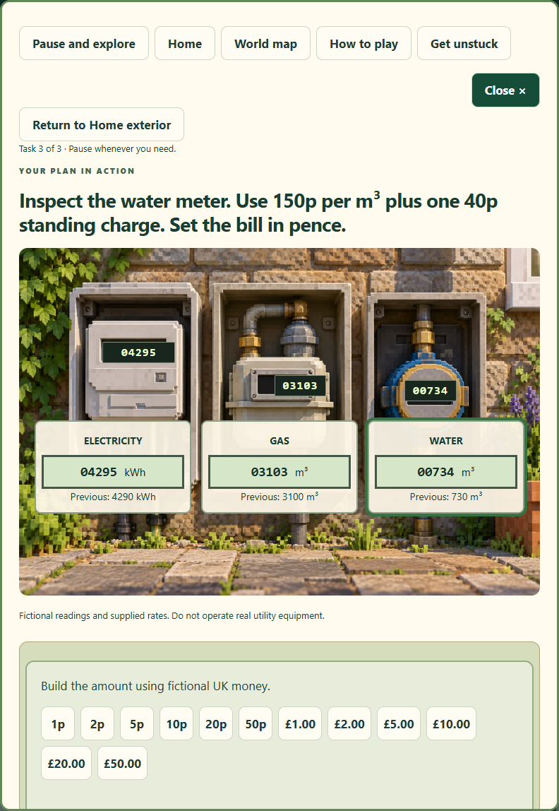

# Home exterior: before and after

Baseline: 0a036f6. Fictional fixtures at 820 × 1180. The after activity images show the actual selected workbench; before images for Bins and Utilities demonstrate the incorrect return to Post. Full four-size private/demo screenshots are available in the Home CI artifact and the delivered local gallery.

## Home exterior

Before

After

## Post and parcels

Before

After

## Bins and recycling

Before

After

## Utility meters

Before

After

