# Town navigation: before/after gallery

[Review report](../TOWN-NAVIGATION.md)

All screenshots use fictional local saves. Before is the exact released `7955861`; after is this feature branch. Production means the real production build with intercepted services, not a real learner session. Images are repository files and can be opened or downloaded individually.

The map occupies the full content width after the change. Repair controls now follow the Town possibilities heading; no second map is added. The private legacy-save example names missing starting points beside the disabled Festival button and links to its prerequisite. The demo retains its optional starting-profile policy.

## production — desktop-chromium

Before: map shares the overview with repair controls.

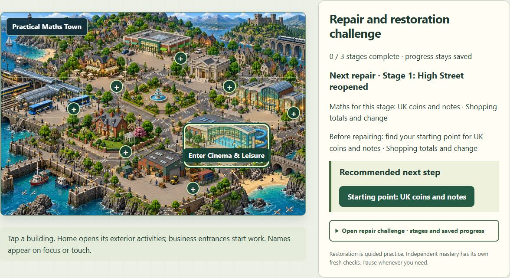

After: one full-width Town map.

## production — ipad-portrait-chromium

Before: map shares the overview with repair controls.

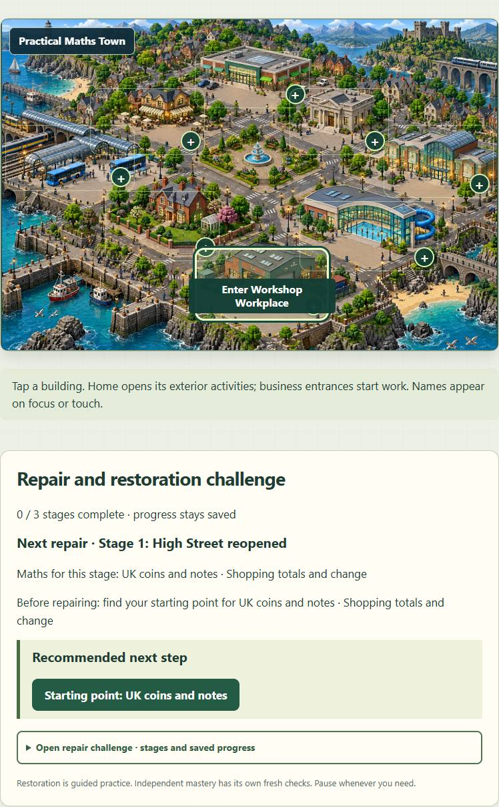

After: one full-width Town map.

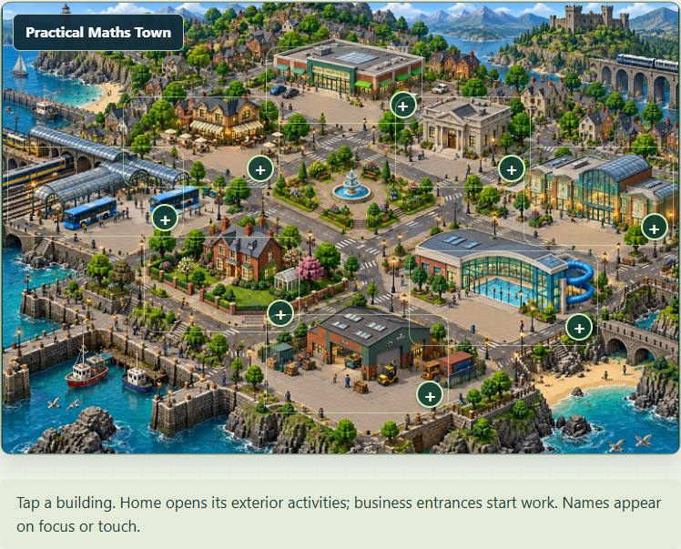

## production — ipad-landscape-chromium

Before: map shares the overview with repair controls.

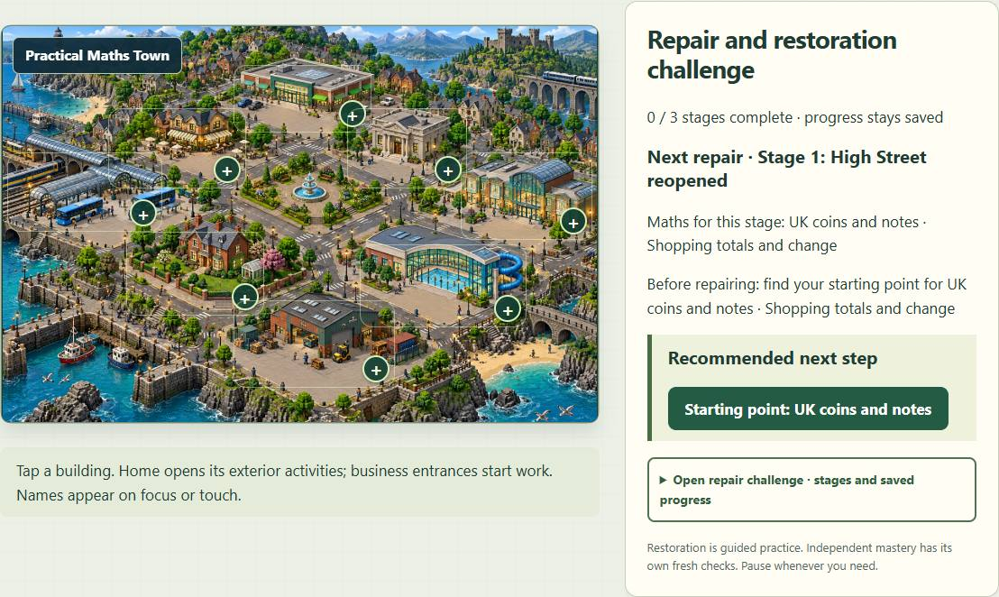

After: one full-width Town map.

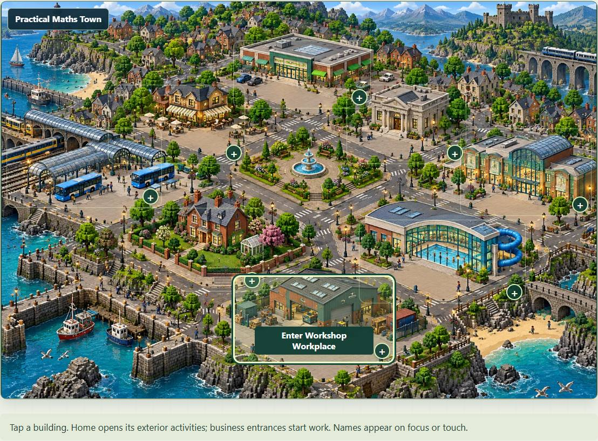

## production — small-touch

Before: map shares the overview with repair controls.

After: one full-width Town map.

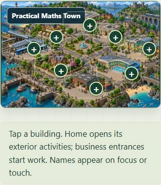

## demo — desktop-chromium

Before: map shares the overview with repair controls.

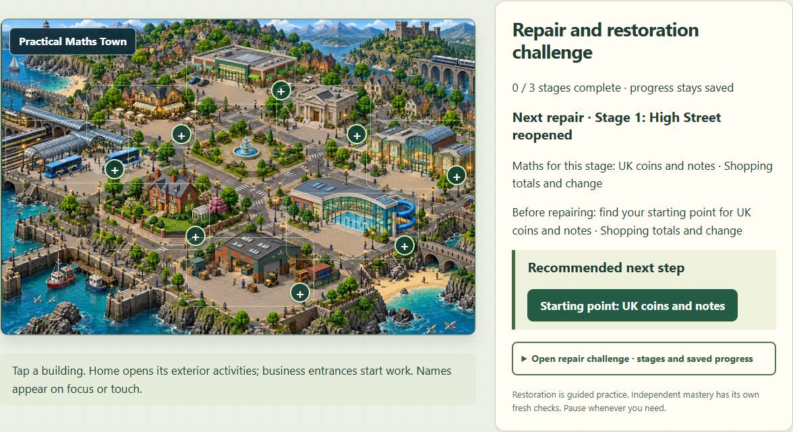

After: one full-width Town map.

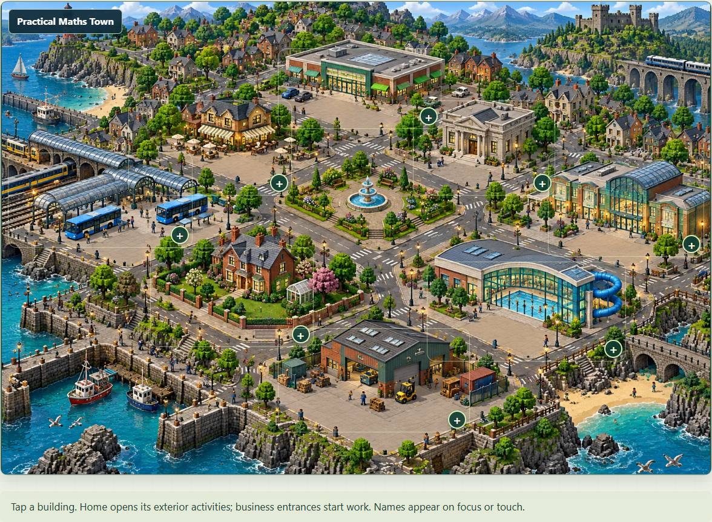

## demo — ipad-portrait-chromium

Before: map shares the overview with repair controls.

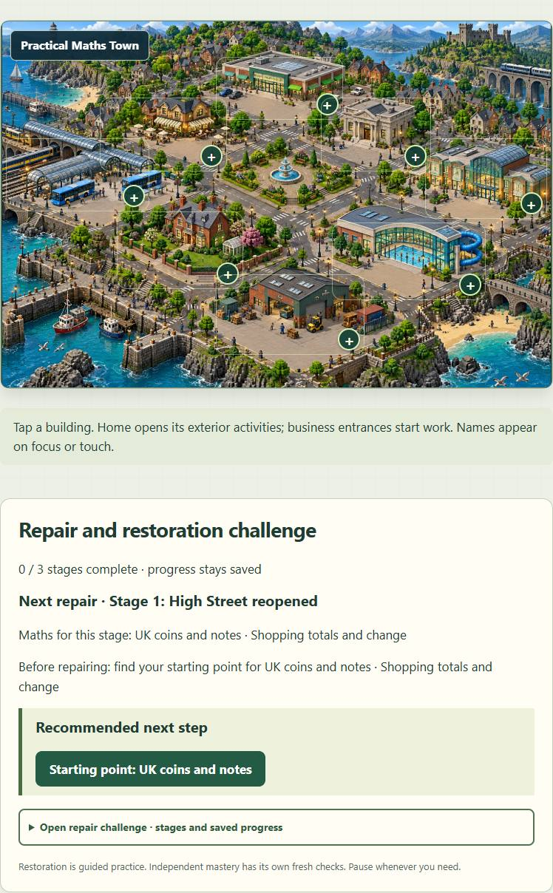

After: one full-width Town map.

## demo — ipad-landscape-chromium

Before: map shares the overview with repair controls.

After: one full-width Town map.

## demo — small-touch

Before: map shares the overview with repair controls.

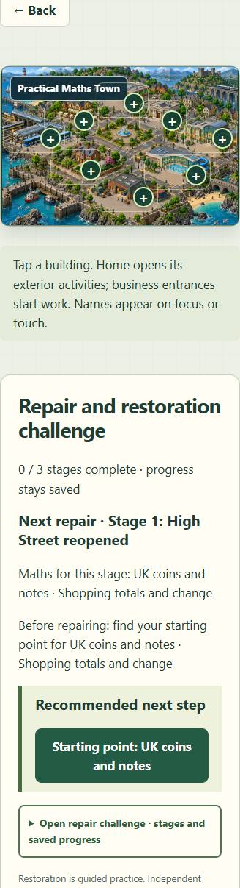

After: one full-width Town map.

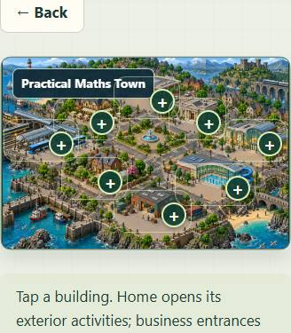

## Repair below the heading: production, desktop-chromium

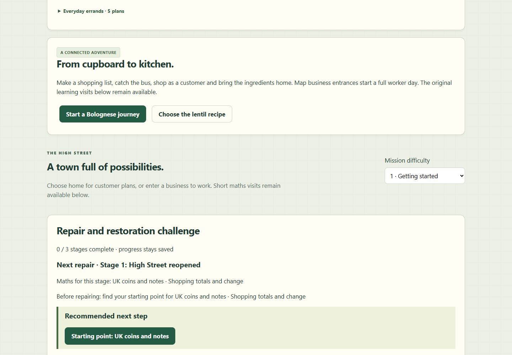

## Repair below the heading: production, small-touch

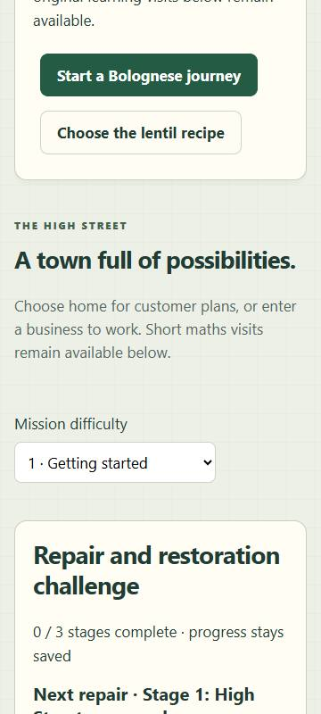

## Repair below the heading: demo, desktop-chromium

## Repair below the heading: demo, small-touch

## Private legacy save and Festival requirement — desktop-chromium

Before: generic disabled button with no nearby requirement.

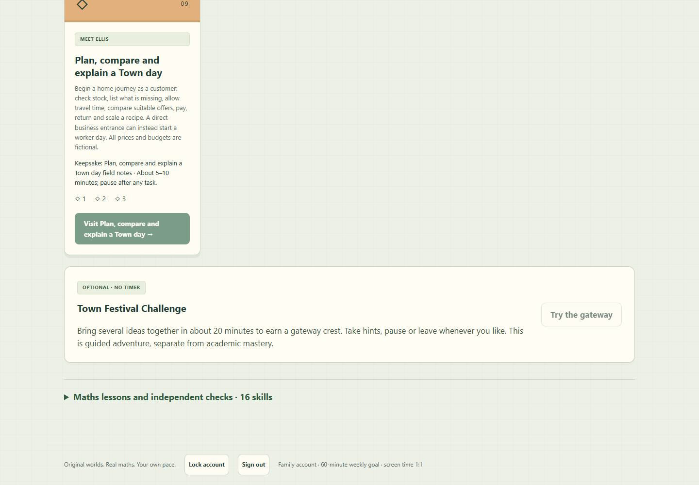

After: named missing starting points, visibly disabled Visit and a working prerequisite route.

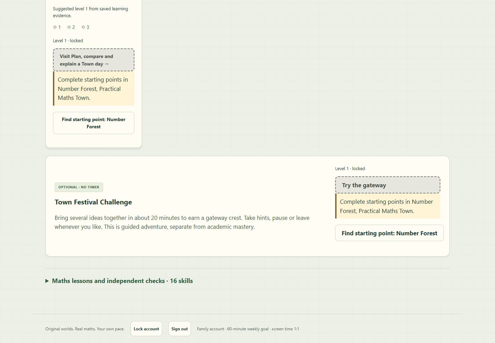

## Private legacy save and Festival requirement — small-touch

Before: generic disabled button with no nearby requirement.

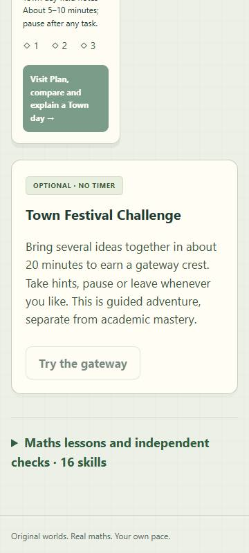

After: named missing starting points, visibly disabled Visit and a working prerequisite route.

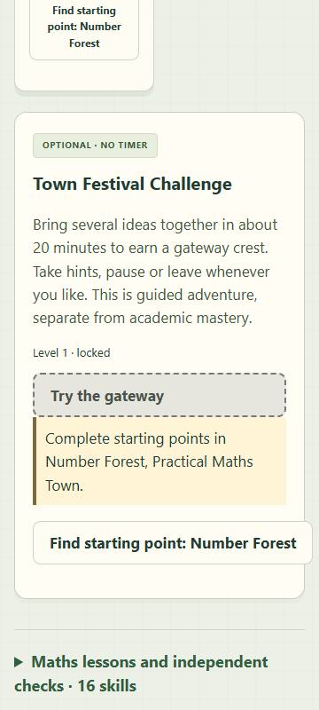

## Available bank-activity: production

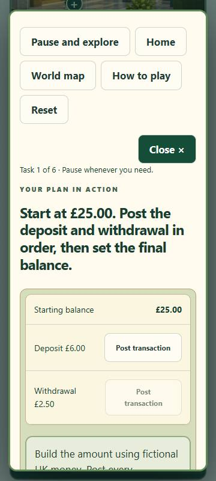

## Available festival-activity: production

## Available bank-activity: demo

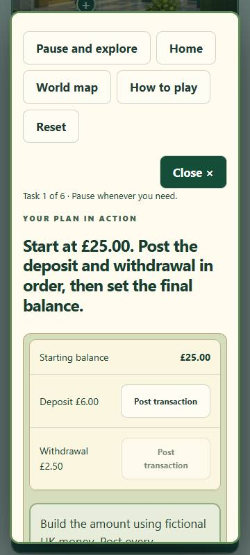

## Available festival-activity: demo

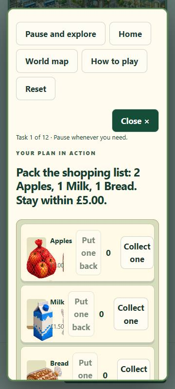
